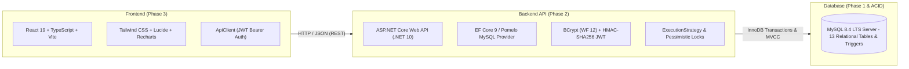

# PayPulse — Enterprise Payroll, Attendance & Leave Management System

[](https://dotnet.microsoft.com/)
[](https://react.dev/)
[](https://www.mysql.com/)
[](https://tailwindcss.com/)
[-success.svg)]()
[]()

**PayPulse** is a production-grade, enterprise-ready full-stack workforce compensation, attendance, and leave management system. It unites a robust **MySQL 8.4 LTS** relational database, an **ASP.NET Core Web API (.NET 10)** backend with Entity Framework Core, and a modern, responsive **React 19** frontend styled with Tailwind CSS.

---

## 🌟 Architecture Overview



### Full-Stack Highlights

- **Phase 1: Database Architecture**: Authoritative 3NF/BCNF relational database with 13 core InnoDB tables, triggers, views, stored procedures, and 105 realistic workforce records.
- **Phase 2: ASP.NET Core Web API**: Clean Architecture (.NET 10), EF Core Pomelo MySQL provider, BCrypt password hashing (work factor 12), symmetric HMAC-SHA256 JWT Bearer authentication, and 5-role RBAC enforcement across 38 REST endpoints.
- **Phase 3: React Frontend & UI**: Modern enterprise SaaS dashboard built with React 19, TypeScript, Tailwind CSS, Lucide icons, and Recharts visualizations. Dual-mode support (live REST API vs. mock DB), responsive navigation, and 28 dedicated application pages.
- **Transaction & Concurrency Layer**: ACID-compliant execution strategies, row-level locking (`SELECT ... FOR UPDATE`), idempotency guards, and automated rollback/concurrency test suites.

---

## 🏛️ Repository Structure

```
PayPulse/
├── src/
│   ├── PayPulse.Domain/          # Phase 2: Domain Entities, Enums & Exceptions
│   ├── PayPulse.Application/     # Phase 2: DTOs, Interfaces, Service Implementations & Transactions
│   ├── PayPulse.Infrastructure/  # Phase 2: EF Core DbContext, Configurations & Security Services
│   ├── PayPulse.Api/             # Phase 2: ASP.NET Core Host, Controllers & Middleware
│   ├── app/                      # Phase 3: React Router, Providers, Env Configuration
│   ├── components/               # Phase 3: UI Primitives & Application Shell
│   ├── contexts/                 # Phase 3: AuthContext, ToastContext, NotificationContext
│   ├── features/                 # Phase 3: Role-tailored dashboards (Admin, HR, Payroll, etc.)
│   ├── pages/                    # Phase 3: 28 Feature Pages (Workforce, Leaves, Payroll, etc.)
│   ├── services/api/             # Phase 3: Centralized ApiClient & 13 Feature API Services
│   └── types/                    # Phase 3: TypeScript view models & DTOs
├── tests/
│   ├── PayPulse.UnitTests/       # Phase 2: Unit tests for salary math & leave quota logic (11 tests)
│   └── PayPulse.IntegrationTests/# Phase 2: API & Transaction Integration tests (24 tests)
├── src/test/                     # Phase 3: Vitest & React Testing Library frontend tests (46 tests)
├── sql/                          # Phase 1: MySQL DDL, DML, triggers, views, procedures & seed data
│   └── transactions/             # Production transaction scripts & concurrency test suites
└── docs/
    ├── database/                 # Phase 1: Database schema, normalization, transactions & ERD
    ├── backend/                  # Phase 2: Clean Architecture, API endpoints & transaction runbook
    ├── frontend/                 # Phase 3: Component design, design tokens & UI testing specs
    └── testing/                  # Comprehensive test verification reports
```

---

## 🚀 Quickstart Guide

### 1. Database Setup (Phase 1)
Ensure MySQL 8.4 is running (via Docker container or native service):
```bash
# Start Docker MySQL container
docker start paypulse-mysql

# Verify database connection
docker exec paypulse-mysql mysql -upaypulse_user -pPayPulseUser@2026! paypulse_db -e "SELECT COUNT(*) FROM Employee;"
```

### 2. Backend Web API (Phase 2)
```bash
# Run backend test suites (35 tests, 100% pass)
dotnet test

# Launch the Web API server (port 5000)
dotnet run --project src/PayPulse.Api --urls "http://127.0.0.1:5000"
```
*Swagger UI is accessible at:* `http://localhost:5000/swagger`

### 3. Frontend Web Application (Phase 3)
```bash
# Install NPM dependencies
npm install

# Run frontend tests (46 tests, 100% pass)
npm test

# Build production bundle
npm run build

# Start Vite development server
npm run dev
```
*Access frontend portal at:* `http://localhost:5173`

---

## 🔐 Pre-Configured Test Credentials

| Username | Role | Password | Primary Scope |
| :--- | :--- | :--- | :--- |
| **`admin`** | System Administrator | `Password@123` | Full administrative control, system audit logs |
| **`farzana.hr`** | HR Manager | `Password@123` | Workforce onboarding, department & leave approvals |
| **`rafiq.payroll`** | Payroll Officer | `Password@123` | Payroll generation, finalization & BEFTN disbursements |
| **`mahbub.supervisor`**| Department Supervisor| `Password@123` | Department attendance oversight & leave approvals |
| **`nusrat.employee`** | Employee | `Password@123` | Self-service attendance, leave requests & payslips |

---

## 📚 Complete Project Documentation

- **Database Documentation**
  * [Database Overview & Architecture](docs/database/database-overview.md)
  * [Data Dictionary & Field Specifications](docs/database/data-dictionary.md)
  * [Entity Relationships & Cardinality](docs/database/entity-relationships.md)
  * [Entity-Relationship Diagram (ERD)](docs/database/erd.md)
  * [Normalization Analysis (3NF/BCNF)](docs/database/normalization.md)
  * [Business Rules & Invariants](docs/database/business-rules.md)
  * [Indexes, Clustering & Query Performance](docs/database/indexes-and-performance.md)
  * [Triggers, Procedures & Functions](docs/database/triggers-procedures-functions.md)
  * [Transactions, ACID & Concurrency Control](docs/database/transactions.md)
  * [Database Testing Verification Report](docs/database/testing-report.md)
- **Backend Documentation**
  * [Clean Architecture & Layer Design](docs/backend/architecture.md)
  * [REST API Endpoints Specification (38 Endpoints)](docs/backend/api-endpoints.md)
  * [Authentication, JWT & RBAC Enforcement](docs/backend/authentication-and-authorization.md)
  * [Database Integration & EF Core Mapping](docs/backend/database-integration.md)
  * [Transaction Management & Execution Strategy](docs/backend/transaction-management.md)
  * [Business Logic & Mathematical Formulations](docs/backend/business-logic.md)
  * [Backend Configuration Runbook](docs/backend/configuration-and-running.md)
  * [Backend Testing Verification Report](docs/backend/testing-report.md)
- **Frontend Documentation**
  * [Component Architecture](docs/frontend/architecture.md)
  * [UI Design System & Tokens](docs/frontend/ui-design-system.md)
  * [Routes, Navigation & Permissions](docs/frontend/routes-and-permissions.md)
  * [API Integration & Services](docs/frontend/api-integration.md)
  * [Responsive Design & Breakpoints](docs/frontend/responsive-design.md)
  * [Setup, Development & Build Runbook](docs/frontend/running-and-building.md)
  * [Frontend Testing Verification Report](docs/frontend/testing-report.md)
- **Comprehensive Testing Reports**
  * [Database & Backend Testing Report](docs/testing/transaction-test-report.md)
