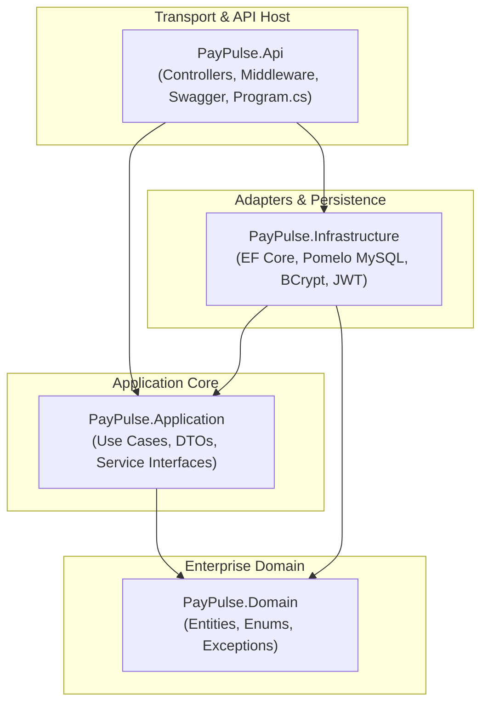
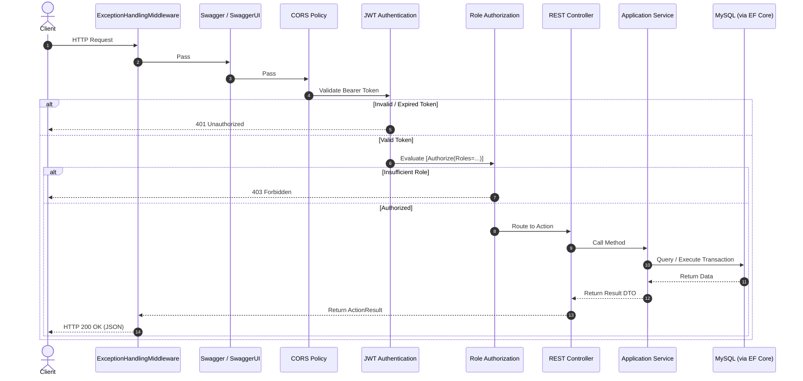

# Backend Architecture & System Design

This document details the architectural principles, module design, dependency flow, and operational lifecycle of the **PayPulse** ASP.NET Core Web API backend.

---

## 1. Architectural Philosophy: Clean Architecture

The PayPulse backend is organized according to the principles of **Clean Architecture** (Ports & Adapters / Onion Architecture). The core tenet is that high-level business rules and domain logic never depend on external concerns such as databases, frameworks, or transport protocols. All external systems depend on internal abstractions.

### Layer Separation & Responsibilities

1. **`PayPulse.Domain` (Core Domain Layer)**
   - **Zero external dependencies**: Contains pure C# types without dependencies on EF Core, ASP.NET Core, or third-party libraries.
   - **Entities**: 13 relational entities matching the Phase 1 MySQL schema (`UserAccount`, `Department`, `Designation`, `Employee`, `SalaryStructure`, `AttendanceLog`, `LeaveType`, `LeaveAllocation`, `LeaveRequest`, `MonthlyPayroll`, `PayrollComponentDetail`, `DisbursementRecord`, `SystemAuditLog`).
   - **Enums & Constants**: Standardized roles (`UserRoles`) and statuses.
   - **Domain Exceptions**: Semantic exception types (`NotFoundException`, `BusinessRuleException`, `ForbiddenException`, `DuplicateEntityException`, `UnauthorizedException`).

2. **`PayPulse.Application` (Business Logic & Use Cases)**
   - Depends only on `PayPulse.Domain`.
   - **Interfaces**: Defines contracts for persistence (`IAppDbContext`), security (`IPasswordHasher`, `IJwtTokenGenerator`), contextual user state (`ICurrentUserService`), and 13 functional service interfaces.
   - **Data Transfer Objects (DTOs)**: Strongly typed request contracts and response projections formatted for RESTful API consumers.
   - **Service Implementations**: Comprehensive domain business logic, salary calculation algorithms, leave balance ledger tracking, and batch processing logic.

3. **`PayPulse.Infrastructure` (Data Persistence & Security Infrastructure)**
   - Implements abstractions defined by `PayPulse.Application`.
   - **Entity Framework Core**: `AppDbContext` configuring table mappings, primary keys, foreign keys, constraints, and precision via Fluent API configurations (`EntityConfigurations.cs`).
   - **Pomelo MySQL Provider**: High-throughput MySQL client configured for `utf8mb4` encoding, connection pooling, and connection resiliency (`EnableRetryOnFailure`).
   - **Security Services**: `BCryptPasswordHasher` (work factor 12) and `JwtTokenGenerator` (symmetric HMAC-SHA256).

4. **`PayPulse.Api` (Presentation & HTTP Host)**
   - ASP.NET Core Web API hosting environment.
   - **Controllers**: 13 thin, RESTful controllers delegating directly to application service interfaces.
   - **Middleware**: Global exception handling, authentication, authorization, and CORS handling.
   - **Swagger / OpenAPI**: Interactive API documentation generated via Swashbuckle with Bearer JWT integration.

---

## 2. Dependency Injection Topology

Services are registered in `Program.cs` via modular extension methods in their respective projects (`AddApplication()` and `AddInfrastructure(configuration)`).

| Component / Interface | Implementation | Lifetime | Rationale |
| :--- | :--- | :--- | :--- |
| `IAppDbContext` | `AppDbContext` | **Scoped** | Per-HTTP-request unit of work and MySQL connection lifecycle |
| `ICurrentUserService` | `CurrentUserService` | **Scoped** | Reads claims from the current HTTP request `HttpContext` |
| `IPasswordHasher` | `BCryptPasswordHasher` | **Singleton** | Stateless password hashing and verification |
| `IJwtTokenGenerator` | `JwtTokenGenerator` | **Singleton** | Stateless cryptographic token issuing |
| `IAuthService` | `AuthService` | **Scoped** | Transactional credential and audit logic |
| `IEmployeeService` | `EmployeeService` | **Scoped** | Database access scoped to request |
| `IPayrollService` | `PayrollService` | **Scoped** | Unit of work coordination for payroll processing |
| `ILeaveService` | `LeaveService` | **Scoped** | Leave quota validation and transaction handling |
| `IAttendanceService` | `AttendanceService` | **Scoped** | Attendance check-in / check-out logging |
| `IDepartmentService` | `DepartmentService` | **Scoped** | Master department management |
| `IDesignationService` | `DesignationService` | **Scoped** | Job title and salary bracket management |
| `ISalaryService` | `SalaryService` | **Scoped** | Compensation structure management |
| `IDisbursementService`| `DisbursementService` | **Scoped** | Payment authorization and ledger updates |
| `IAuditService` | `AuditService` | **Scoped** | Security audit query service |
| `IReportService` | `ReportService` | **Scoped** | Analytical aggregation service |
| `ISearchService` | `SearchService` | **Scoped** | Global cross-entity search |
| `INotificationService`| `NotificationService` | **Scoped** | In-app user notifications |

---

## 3. Middleware Pipeline & Request Lifecycle

The HTTP request pipeline in `Program.cs` is strictly ordered to ensure security, error encapsulation, and correct contextual binding:

### Centralized Exception Handling

All exceptions thrown across the application are intercepted by `ExceptionHandlingMiddleware` before leaving the process:

| Exception Type | HTTP Status | Response Payload | Description |
| :--- | :---: | :--- | :--- |
| `NotFoundException` | **404 Not Found** | `{"success": false, "message": "..."}` | Entity not found in database |
| `BusinessRuleException`| **400 Bad Request** | `{"success": false, "message": "..."}` | Violates business constraints (e.g., negative balance) |
| `DuplicateEntityException`| **409 Conflict** | `{"success": false, "message": "..."}` | Unique constraint violation (e.g., duplicate email) |
| `UnauthorizedException`| **401 Unauthorized**| `{"success": false, "message": "..."}` | Invalid credentials or missing authentication |
| `ForbiddenException` | **403 Forbidden** | `{"success": false, "message": "..."}` | Account suspended or insufficient permission |
| `Exception` (unhandled) | **500 Internal Error**| `{"success": false, "message": "..."}` | Logged with full stack trace; safe message returned |

---

## 4. Query Tracking & Performance Optimizations

1. **Explicit AsNoTracking() for Read Queries**: All read-only endpoints (e.g., reports, lists, paginated views) use EF Core `.AsNoTracking()` to eliminate tracking overhead and memory footprint.
2. **Selective Eager Loading**: Navigations required for DTO mapping are explicitly loaded using `.Include()` and `.ThenInclude()`.
3. **Paging at Query Level**: Paginated endpoints use `.Skip((page - 1) * pageSize).Take(pageSize)` to perform offset-limit pagination at the MySQL server level.
4. **Execution Strategy**: The MySQL provider is initialized with `EnableRetryOnFailure(maxRetryCount: 5, maxRetryDelay: TimeSpan.FromSeconds(10))` to automatically handle transient network disconnections.
