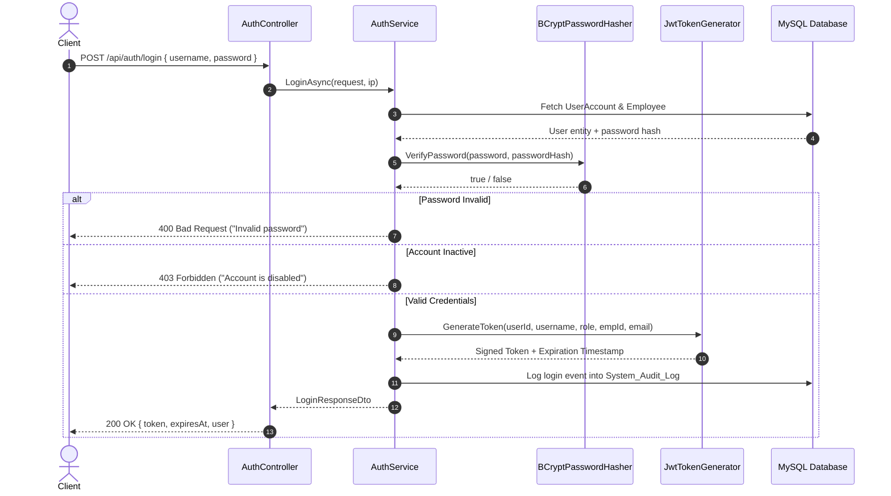

# Authentication, Authorization & Security Architecture

This document specifies the security mechanisms, token management, cryptographic standards, and access control models implemented in the **PayPulse** backend.

---

## 1. Authentication Mechanism: JSON Web Tokens (JWT)

PayPulse implements stateless authentication using standard **JSON Web Tokens (JWT)** over the HTTP `Authorization: Bearer <token>` scheme.

### Token Lifecycle & Structure

When an employee or administrator provides valid credentials via `POST /api/auth/login`, the backend generates a signed JWT access token.



### JWT Claims Payload

Each issued token embeds standard and custom claims:

```json
{
  "http://schemas.xmlsoap.org/ws/2005/05/identity/claims/nameidentifier": "1",
  "http://schemas.xmlsoap.org/ws/2005/05/identity/claims/name": "admin",
  "http://schemas.microsoft.com/ws/2008/06/identity/claims/role": "System Administrator",
  "http://schemas.xmlsoap.org/ws/2005/05/identity/claims/emailaddress": "admin@paypulse.internal",
  "employee_id": "1",
  "jti": "b18f8e32-b7e5-4a62-9e3e-4fb800dc0913",
  "exp": 1791852000,
  "iss": "PayPulse",
  "aud": "PayPulseApp"
}
```

### Token Validation Rules (`Program.cs`)

ASP.NET Core JWT Bearer middleware validates all incoming requests against strict security parameters:
- **Signature Validation**: Verifies HMAC-SHA256 signature using symmetric secret key.
- **Issuer Validation**: Requires exact match with configured `Jwt:Issuer` (`PayPulse`).
- **Audience Validation**: Requires exact match with configured `Jwt:Audience` (`PayPulseApp`).
- **Lifetime Validation**: Rejects expired tokens.
- **ClockSkew = TimeSpan.Zero**: Eliminates default 5-minute clock drift tolerance to enforce immediate expiration upon expiry.

---

## 2. Password Hashing: BCrypt (Work Factor 12)

Passwords are never stored in plaintext or reversible encryption.

- **Algorithm**: BCrypt (`BCrypt.Net-Next`).
- **Work Factor**: `12` (2^12 = 4,096 hashing iterations).
- **Salting**: Cryptographically random 128-bit salt uniquely generated per password hash, preventing rainbow-table attacks.
- **Enhanced Verification**: Implements `EnhancedHashPassword` and `EnhancedVerify` with fallback to standard BCrypt verification for backward compatibility.

---

## 3. Role-Based Access Control (RBAC) Matrix

PayPulse defines five distinct enterprise roles (`UserRoles` enum):

1. **`System Administrator`**: Full technical administrative authority, system audits, user management, and configuration.
2. **`HR Manager`**: Workforce onboarding, departmental structuring, designation salary bands, and leave approvals.
3. **`Payroll Officer`**: Compensation calculations, monthly payroll generation, payslip finalization, and banking disbursements.
4. **`Department Supervisor`**: Team attendance oversight and departmental leave approvals.
5. **`Employee`**: Self-service portal for viewing personal payslips, attendance records, and applying for leaves.

### Complete Permissions Matrix

| Endpoint Area / Action | System Administrator | HR Manager | Payroll Officer | Department Supervisor | Employee |
| :--- | :---: | :---: | :---: | :---: | :---: |
| **Authenticate / View Own Profile** | ✅ | ✅ | ✅ | ✅ | ✅ |
| **View Employee Directory** | ✅ | ✅ | ✅ | ✅ | ✅ (Directory) |
| **Onboard / Edit Employees** | ✅ | ✅ | ❌ | ❌ | ❌ |
| **Manage Salary Structures** | ✅ | ✅ | ✅ (Read/Preview) | ❌ | ❌ |
| **Submit Own Leave Request** | ✅ | ✅ | ✅ | ✅ | ✅ |
| **Approve / Reject Leave** | ✅ | ✅ | ❌ | ✅ | ❌ |
| **Log Personal Attendance** | ✅ | ✅ | ✅ | ✅ | ✅ |
| **Manual Attendance Correction** | ✅ | ✅ | ❌ | ✅ | ❌ |
| **Run Monthly Payroll Batch** | ✅ | ❌ | ✅ | ❌ | ❌ |
| **Finalize Monthly Payroll** | ✅ | ❌ | ✅ | ❌ | ❌ |
| **Authorize BEFTN Disbursements** | ✅ | ❌ | ✅ | ❌ | ❌ |
| **View Own Payslips & PDF** | ✅ | ✅ | ✅ | ✅ | ✅ (Self only) |
| **Executive Payroll Cost Report**| ✅ | ✅ | ✅ | ❌ | ❌ |
| **System Security Audit Trail** | ✅ | ❌ | ❌ | ❌ | ❌ |

---

## 4. Horizontal Authorization & Data Isolation

In addition to coarse-grained role checks (`[Authorize(Roles = ...)]`), PayPulse enforces **horizontal data boundary checks** in the application layer via `ICurrentUserService`:

1. **Payslip Isolation**:
   - An employee with role `Employee` requesting `/api/payroll/{id}` is verified against `p.EmployeeId == currentUserService.EmployeeId`. Accessing another employee's payslip results in `ForbiddenException` (HTTP 403).
2. **Leave Application Isolation**:
   - When submitting leave (`POST /api/leave/requests`), regular employees cannot apply on behalf of other employees; the application strictly sets `EmployeeId = currentUserService.EmployeeId`.
3. **Account Deactivation Safeguard**:
   - If an employee's `IsActive` flag in `User_Account` is toggled to `false`, all protected API requests immediately fail with HTTP 403 Forbidden.
