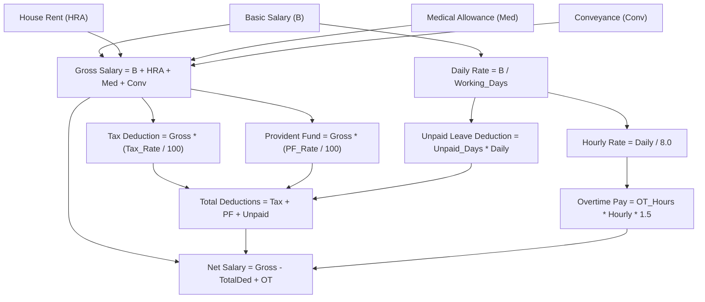
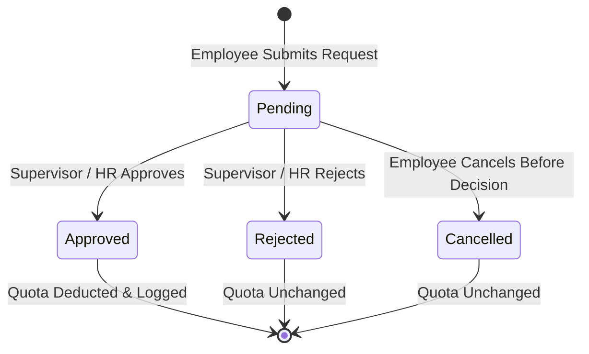
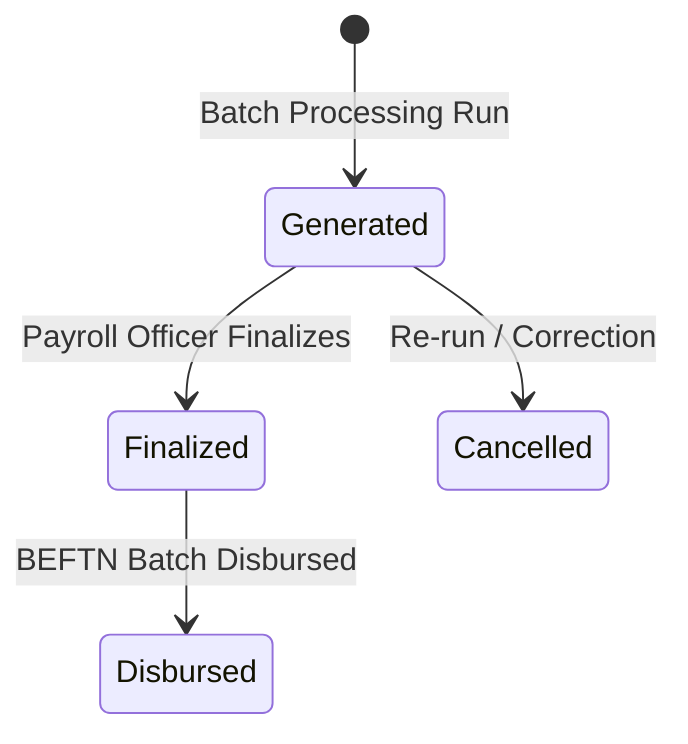

# Business Logic, Calculation Rules & Workflow Specifications

This document outlines the core business domain algorithms, compensation math, attendance classification rules, and leave management workflows implemented in the **PayPulse** backend.

---

## 1. Compensation & Payroll Calculation Mathematics

Monthly compensation settlement in PayPulse is governed by strict deterministic formulas implemented in `SalaryService` and `PayrollService`.

### Mathematical Definitions

1. **Gross Salary**:
   $$\text{Gross Salary} = \text{Basic Salary} + \text{House Rent Allowance} + \text{Medical Allowance} + \text{Conveyance Allowance}$$

2. **Daily Pro-Rata Rate**:
   $$\text{Daily Rate} = \frac{\text{Basic Salary}}{\text{Working Days in Month}}$$

3. **Standard Hourly Rate**:
   $$\text{Hourly Rate} = \frac{\text{Daily Rate}}{8.00}$$

4. **Overtime Compensation (1.5x Statutory Premium)**:
   $$\text{Overtime Rate} = \text{Hourly Rate} \times 1.50$$
   $$\text{Overtime Pay} = \text{Total Monthly Overtime Hours} \times \text{Overtime Rate}$$

5. **Tax & Provident Fund Deductions**:
   $$\text{Tax Withholding} = \text{Gross Salary} \times \left(\frac{\text{Tax Deduction Rate}}{100}\right)$$
   $$\text{Provident Fund} = \text{Gross Salary} \times \left(\frac{\text{Provident Fund Rate}}{100}\right)$$

6. **Unpaid Leave Penalty Deduction**:
   $$\text{Unpaid Leave Deduction} = \text{Unpaid Leave Days} \times \text{Daily Rate}$$

7. **Net Payable Salary**:
   $$\text{Total Deductions} = \text{Tax Withholding} + \text{Provident Fund} + \text{Unpaid Leave Deduction}$$
   $$\text{Net Salary} = (\text{Gross Salary} - \text{Total Deductions}) + \text{Overtime Pay}$$

### Itemized Line Items (`Payroll_Component_Detail`)

Every monthly payroll automatically records itemized line items:
- **Earnings Lines**: Basic Salary, House Rent Allowance, Medical Allowance, Conveyance Allowance, Overtime Pay.
- **Deduction Lines**: Income Tax Withholding, Provident Fund Contribution, Unpaid Leave Penalty.

---

## 2. Attendance & Biometric Work Status Rules

Attendance entries in `Attendance_Log` are classified automatically based on check-in and check-out timestamps:

| Metric / Event | Rule / Condition | Resulting Status |
| :--- | :--- | :--- |
| **Check-in Timestamp** | After 09:30 AM (9:30:00) | `Late` (if total hours >= 8) |
| **Working Hours** | Total Hours >= 8.00 hours | `Present` |
| **Half-Day Threshold** | 4.00 hours <= Total Hours < 8.00 hours | `Half-Day` |
| **Minimum Threshold** | Total Hours < 4.00 hours | `Absent` |
| **Overtime Threshold** | Total Hours > 8.00 hours | Overtime Hours = Total Hours - 8.00 (capped at 16 hrs) |

---

## 3. Leave Management & Quota Enforcement

### Statutory Leave Policies (`Leave_Type`)

PayPulse preconfigures 6 statutory leave types matching regional labor law:

| Leave Type | Annual Quota | Paid / Unpaid | Carry Forward |
| :--- | :---: | :---: | :---: |
| **Casual Leave** | 10 days | Paid | No |
| **Medical Leave** | 14 days | Paid | No |
| **Earned Leave** | 15 days | Paid | Yes |
| **Maternity Leave** | 120 days | Paid | No |
| **Paternity Leave** | 10 days | Paid | No |
| **Unpaid Leave** | 30 days | Unpaid | No |

### Leave Application & Approval Lifecycle

1. **Application Validation**:
   - Total Days requested = `EndDate - StartDate + 1`.
   - The employee must possess an active allocation record in `Leave_Allocation` for the current calendar year.
   - **Balance Check**: `Days_Remaining >= Total_Days`. If insufficient, throws `BusinessRuleException` with the exact shortfall.
2. **Atomic Approval & Balance Deduction**:
   - When an approver executes `/api/leave/requests/{id}/approve`:
     - Updates `Leave_Request.Status` to `Approved`.
     - Records `Approved_By_User_ID` and `Approved_At`.
     - Updates `Leave_Allocation`:
       $$\text{Days\_Used}_{\text{new}} = \text{Days\_Used}_{\text{old}} + \text{Total Days}$$
       $$\text{Days\_Remaining}_{\text{new}} = \text{Total\_Allocated} - \text{Days\_Used}_{\text{new}}$$

---

## 4. Payroll Settlement State Machine

1. **Batch Generation**:
   - Checks if payroll has already been processed for the target month (`Payroll_Year`, `Payroll_Month`).
   - If any record is in `Finalized` or `Disbursed` status, batch execution is blocked to safeguard accounting integrity.
2. **Finalization**:
   - Locks the payslip calculation. Changes to employee salary structures after finalization will not mutate historical payslips.
3. **Disbursement Authorization**:
   - Generates a unique BEFTN reference code (`BEFTN-{YEAR}{MONTH}-{EMP_CODE}-{RANDOM}`).
   - Writes an immutable record to `Disbursement_Record`.
   - Transitions payroll state to `Disbursed`.
