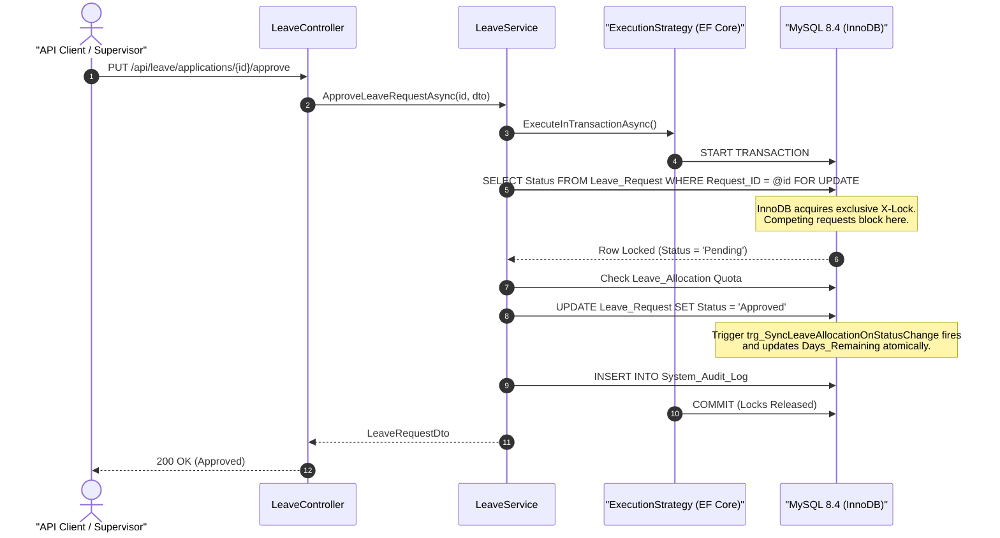

# PayPulse — Backend Transaction Management & EF Core Integration

## 1. Overview

In **PayPulse**, data consistency across the ASP.NET Core backend is maintained by pairing Entity Framework Core with MySQL InnoDB's transactional engine. Because the application interacts with mission-critical financial, employee, and attendance records, all mutating operations involving multiple tables or invariant validations are executed within explicit atomic transaction blocks.

---

## 2. EF Core Execution Strategy & Retrying Resiliency

### 2.1. The Retrying Strategy Challenge
In cloud and distributed deployments, transient network hiccups can break active database connections. PayPulse configures Pomelo's MySQL provider with connection resiliency:

```csharp
builder.Services.AddDbContext<AppDbContext>(options =>
{
    options.UseMySql(connectionString, ServerVersion.AutoDetect(connectionString), mySqlOptions =>
    {
        mySqlOptions.EnableRetryOnFailure(
            maxRetryCount: 3,
            maxRetryDelay: TimeSpan.FromSeconds(5),
            errorNumbersToAdd: null);
    });
});
```

When `EnableRetryOnFailure` is active, EF Core instantiates `MySqlRetryingExecutionStrategy`. By design, EF Core prohibits calling `context.Database.BeginTransactionAsync()` directly outside an execution strategy, throwing:
> `InvalidOperationException: The configured execution strategy 'MySqlRetryingExecutionStrategy' does not support user-initiated transactions. Use the execution strategy returned by 'DbContext.Database.CreateExecutionStrategy()' to execute all the operations in the transaction as a retriable unit.`

### 2.2. The Solution: `TransactionExtensions.cs`
To provide clean, consistent, and boilerplate-free transaction management across all application services, PayPulse implements the `ExecuteInTransactionAsync` pattern in `PayPulse.Application.Common.Extensions`:

```csharp
public static class TransactionExtensions
{
    public static async Task ExecuteInTransactionAsync(
        this IAppDbContext context,
        Func<Task> action,
        CancellationToken cancellationToken = default)
    {
        var strategy = context.Database.CreateExecutionStrategy();
        await strategy.ExecuteAsync(async () =>
        {
            await using var transaction = await context.Database.BeginTransactionAsync(cancellationToken);
            try
            {
                await action();
                await transaction.CommitAsync(cancellationToken);
            }
            catch
            {
                await transaction.RollbackAsync(cancellationToken);
                throw;
            }
        });
    }

    public static async Task<T> ExecuteInTransactionAsync<T>(
        this IAppDbContext context,
        Func<Task<T>> action,
        CancellationToken cancellationToken = default)
    {
        var strategy = context.Database.CreateExecutionStrategy();
        return await strategy.ExecuteAsync(async () =>
        {
            await using var transaction = await context.Database.BeginTransactionAsync(cancellationToken);
            try
            {
                var result = await action();
                await transaction.CommitAsync(cancellationToken);
                return result;
            }
            catch
            {
                await transaction.RollbackAsync(cancellationToken);
                throw;
            }
        });
    }
}
```

This guarantees that:
1. All database operations inside the lambda belong to a single physical transaction.
2. If any step fails, `RollbackAsync()` is called immediately and the exception propagates.
3. Transient errors automatically retry the entire transactional unit safely.

---

## 3. Application Services Transaction Architecture



### 3.1. Employee Service (`EmployeeService.cs`)
- **Operations Wrapped**:
  1. Password hashing (`BCrypt`) and account record insertion into `User_Account`.
  2. Sequential employee code generation (`EMP-YYYY-XXXX`).
  3. Profile record insertion into `Employee` table.
  4. Salary structure configuration into `Salary_Structure`.
  5. Annual leave allocation provisioning for all active `Leave_Type` entities.
  6. Audit logging into `System_Audit_Log`.
- **Integrity Guarantee**: If any step encounters an invalid foreign key or duplicate key violation (e.g., duplicate National ID), the transaction rolls back. The user account is never left orphaned in the database.

### 3.2. Payroll Service (`PayrollService.cs`)
- **Batch Processing**:
  - Validates payroll period uniqueness.
  - Generates payroll vouchers and itemized payslip components across all active employees.
  - Commits master records, detail lines, and audit trail within an atomic transaction.
- **Disbursement Settlement**:
  - Verifies current status is `'Approved'`.
  - Generates a unique transaction reference formatted as `TXN-YYYYMM-XXXX-GUID`.
  - Mutates `MonthlyPayroll.PayrollStatus = "Disbursed"`.
  - Inserts settlement record into `DisbursementRecord`.
  - If a duplicate disbursement is attempted, the unique constraint `uq_disb_payroll_id` triggers `DbUpdateException`, which is caught and mapped to a clean `BusinessRuleException`.

### 3.3. Leave Service (`LeaveService.cs`)
- **Pessimistic Concurrency**:
  - Leverages an ADO.NET raw query with `SELECT Status FROM Leave_Request WHERE Request_ID = @id FOR UPDATE` directly on the current transaction's connection.
  - In concurrent execution scenarios where two supervisors approve the same request simultaneously, the first thread holds the lock and commits the approval. The second thread unblocks, reads the newly committed status (`Approved`), and aborts immediately with a `BusinessRuleException`.
  - Synchronizes with the native MySQL trigger `trg_SyncLeaveAllocationOnStatusChange` to prevent double deduction.

### 3.4. Attendance Service (`AttendanceService.cs`)
- **Correction Endpoint**: `PUT /api/attendance/{id}/correct`
- **Validation**: Enforces `Check_In <= Check_Out` before persisting.
- **Recalculation**: Recalculates total worked hours dynamically:
  $$\text{HoursWorked} = \frac{\text{CheckOut} - \text{CheckIn}}{60 \text{ minutes}}$$
- **Audit**: Persists full before/after JSON delta in `SystemAuditLog`.

### 3.5. Disbursement Service (`DisbursementService.cs`)
- **Retry Logic**: Provides safe retry for disbursements stuck in `Failed` status.
- **Atomicity**: Re-evaluates bank details and logs audit tracking within `ExecuteInTransactionAsync`.

---

## 4. Idempotency & Error Mapping

| Database Exception | Cause | Application Exception | HTTP Response |
|---|---|---|---|
| `ER_DUP_ENTRY (1062)` on `uq_emp_payroll_period` | Competing payroll generation for same month | `DuplicateEntityException` | `409 Conflict` |
| `ER_DUP_ENTRY (1062)` on `uq_disb_payroll_id` | Duplicate payment settlement attempt | `BusinessRuleException` | `400 Bad Request` |
| `ER_CHECK_CONSTRAINT_VIOLATED (3819)` | Negative component amount or invalid dates | `BusinessRuleException` | `400 Bad Request` |
| Row locked with non-Pending status | Competing approval race | `BusinessRuleException` | `400 Bad Request` |

No raw MySQL error strings, connection strings, or internal stack traces are ever exposed to API clients. All errors are caught by global exception middleware and returned formatted as RFC 7807 Problem Details.
