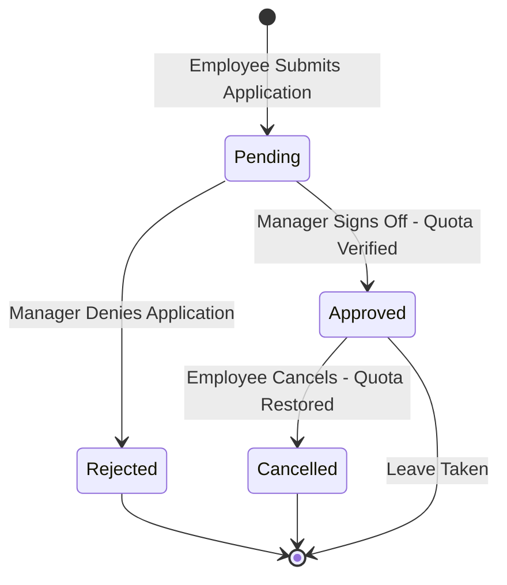

# PayPulse Enterprise Business Rules & Policies

This document formalizes the operational business logic, mathematical payroll formulations, attendance guidelines, leave lifecycle state machines, and banking integration standards enforced by the PayPulse database layer.

---

## 1. Payroll Formulation & Mathematical Specification

Monthly payroll calculations are executed by `sp_ProcessMonthlyPayrollBatch` and evaluated by `fn_CalculateMonthlyNetPay` using the following exact formulas:

### 1.1 Working Days & Daily Pay Rate
- **Standard Billable Working Days**: $W = 26$ days per calendar month (standard corporate calendar excluding weekends and statutory holidays).
- **Per-Day Basic Salary**:
  $$\text{Daily Basic Rate} = \frac{\text{Basic Salary}}{W}$$

### 1.2 Overtime Calculation
- Standard daily shift: 8 working hours (or 9 including lunch/prayer break).
- **Hourly Basic Rate**:
  $$\text{Hourly Rate} = \frac{\text{Basic Salary}}{W \times 8.0}$$
- **Statutory Overtime Multiplier**: $1.5\times$ base hourly rate (per Bangladesh labor practice):
  $$\text{Overtime Rate} = \text{Hourly Rate} \times 1.5$$
  $$\text{Overtime Pay} = \text{Overtime Hours} \times \text{Overtime Rate}$$

### 1.3 Earnings & Allowances
$$\text{Total Allowances} = \text{House Rent} + \text{Medical Allowance} + \text{Conveyance Allowance} + \text{Overtime Pay}$$
$$\text{Gross Salary} = \text{Basic Salary} + \text{Total Allowances}$$

### 1.4 Deductions
1. **Statutory Income Tax Withholding**:
   $$\text{Tax Deduction} = \text{Basic Salary} \times \left(\frac{\text{Tax Deduction Rate}}{100}\right)$$
2. **Provident Fund Contribution**:
   $$\text{Employee PF Deduction} = \text{Basic Salary} \times \left(\frac{\text{Provident Fund Rate}}{100}\right)$$
   *(Note: The employer provides an equal matching 100% contribution).*
3. **Unpaid Leave Penalty Deduction**:
   $$\text{Unpaid Leave Deduction} = \text{Unpaid Leave Days} \times \text{Daily Basic Rate}$$
4. **Total Deductions**:
   $$\text{Total Deductions} = \text{Tax Deduction} + \text{PF Deduction} + \text{Unpaid Leave Deduction}$$

### 1.5 Net Take-Home Salary
$$\text{Net Salary} = \text{Gross Salary} - \text{Total Deductions}$$

---

## 2. Workforce Attendance & Biometric Rules

Daily biometric timekeeping records are captured in `Attendance_Log`:

| Parameter | Boundary / Rule | Database Implementation |
|---|---|---|
| **Standard Shift** | 09:00 AM to 06:00 PM (9.0 Hours) | Logged via `Check_In_Time` and `Check_Out_Time` |
| **Late Tolerance** | Check-in after 09:15 AM classified as `'Late'` | Enforced by API & `Attendance_Status = 'Late'` |
| **Half-Day Shift** | Working duration < 5.0 hours | Status set to `'Half-Day'` |
| **Absence** | Zero punch records on scheduled workday | Status set to `'Absent'` |
| **Duplicate Prevention** | Exactly 1 log per employee per date | Enforced by `UNIQUE (Employee_ID, Work_Date)` |
| **Timestamp Validity** | Check-out must be after check-in | Enforced by CHECK constraint & trigger `trg_ValidateAttendanceTimes` |
| **Overtime Threshold** | Shift duration exceeding 8.0/9.0 hours | Stored in `Overtime_Hours` |

---

## 3. Leave Management State Machine & Quotas

### 3.1 Quota Policies
- **Casual Leave**: 14 days per year (Non-carry forward, Paid).
- **Medical Leave**: 14 days per year (Requires doctor prescription, Paid).
- **Earned Leave**: 15 days per year (Statutory accrual, Carry-forward allowed, Paid).
- **Maternity Leave**: 120 days (Paid per statutory maternity entitlement).
- **Paternity Leave**: 10 days (Paid parental leave).
- **Unpaid Leave**: 30 days maximum (Authorized absence without pay resulting in salary deduction).

### 3.2 State Machine Transition Rules
1. **Application Submission (`Pending`)**:
   - `Total_Days` must be $> 0$ and `End_Date >= Start_Date`.
   - Quota balance in `Leave_Allocation` is verified, but balance is not deducted yet.
2. **Approval (`Approved`)**:
   - Database trigger `trg_EnforceLeaveQuota` verifies `Days_Remaining >= Total_Days`.
   - Database trigger `trg_SyncLeaveAllocationOnStatusChange` increments `Days_Used` and decrements `Days_Remaining`.
3. **Rejection (`Rejected`)**:
   - Quota balance remains unaffected.
4. **Cancellation (`Cancelled`)**:
   - If an approved leave is cancelled prior to occurrence, `trg_SyncLeaveAllocationOnStatusChange` restores `Days_Remaining` and decrements `Days_Used`.

---

## 4. BEFTN Banking Settlement Rules

Electronic wage disbursements comply with the Bangladesh Bank Bangladesh Electronic Funds Transfer Network (BEFTN) standards:

1. **Eligibility**: Only payroll batches in `'Approved'` or `'Finalized'` status can be disbursed.
2. **Atomic Dispatch**: Handled via stored procedure `sp_DisbursePayroll`.
3. **Unique Transaction References**: Every bank transfer voucher is assigned a format:
   `BEFTN-YYYYMMDD-<Payroll_ID>-<RAND>` (enforced by candidate key `uq_disb_txref`).
4. **Data Masking**: Account numbers are masked in all general-access views (`vw_DisbursementReconciliation`) using `fn_MaskBankAccount`.

---

## 5. Security, Audit & Invariant Rules

1. **Password Security**: Passwords must never be stored in plaintext. Seed and production accounts store salted BCrypt/Argon2 hashes.
2. **Append-Only Auditing**: `System_Audit_Log` is append-only. No API user or service account has `UPDATE` or `DELETE` rights on audit logs.
3. **Salary Changes**: Modifying any financial parameters in `Salary_Structure` triggers `trg_AuditSalaryModifications`, capturing before and after values as structured JSON objects in `System_Audit_Log`.
4. **Finalized Payroll Protection**: Triggers `trg_PreventModifyingFinalizedPayroll` and `trg_PreventDeletingFinalizedPayroll` reject any modifications or deletions to records marked `'Finalized'` or `'Disbursed'`.
