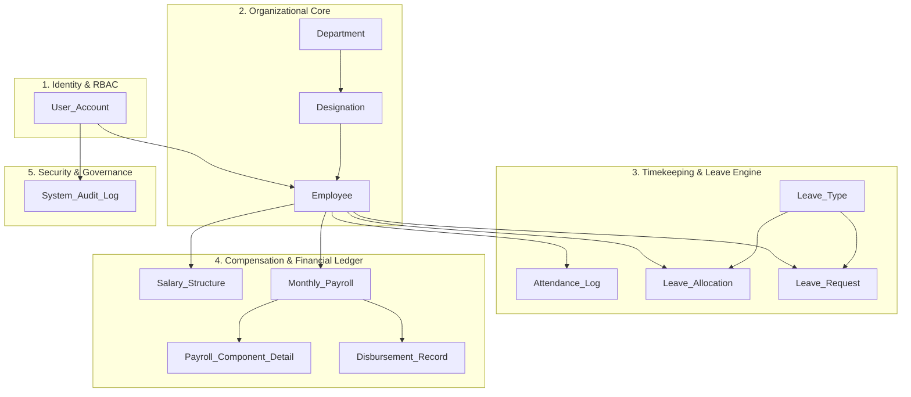

# PayPulse Database System — Architecture & Overview

## 1. System Purpose & Scope

**PayPulse** is an enterprise-grade Human Resources, Attendance, Leave Management, and Payroll Processing platform engineered for corporate operations in Bangladesh. It establishes standardized workforce management, calculates statutory withholdings (Tax and Provident Fund according to Bangladeshi corporate compliance), facilitates electronic bank transfers via the Bangladesh Electronic Funds Transfer Network (BEFTN), and maintains an immutable financial audit trail.

This documentation defines **Phase 1: Database Design, Implementation, Documentation & Testing**. In PayPulse, the database is architected not merely as a passive data store, but as the **computational, referential, and integrity core** of the entire platform.

---

## 2. Multi-Tier Architecture Context

The database is designed database-first to serve as the foundation for the upcoming ASP.NET Core Web API and the existing React frontend:

```text
┌────────────────────────────────────────────────────────────────────────┐
│                        Tier 1: Responsive Web UI                       │
│    • Modern React 19 + TypeScript + Vite + Tailwind CSS                │
│    • Role-Tailored Dashboards (Admin, HR, Payroll, Supervisor, Staff)  │
│    • RESTful API integration via Axios/Fetch with JWT Bearer auth      │
└───────────────────────────────────┬────────────────────────────────────┘
                                    │ HTTP / REST / JSON
                                    ▼
┌────────────────────────────────────────────────────────────────────────┐
│                   Tier 2: ASP.NET Core Web API (.NET 10)               │
│    • Clean Architecture (Domain, Application, Infrastructure, Api)     │
│    • BCrypt Password Hashing (Work Factor 12), JWT Bearer Validation   │
│    • Entity Framework Core 10 (Pomelo.EntityFrameworkCore.MySql)       │
└───────────────────────────────────┬────────────────────────────────────┘
                                    │ MySQL TCP Protocol (Port 3308)
                                    ▼
┌────────────────────────────────────────────────────────────────────────┐
│                      Tier 3: MySQL 8.4 LTS Database                    │
│    • 13 Normalized Relational Tables (InnoDB Storage Engine)           │
│    • 6 Secure Operational Views & 6 Native User-Defined Functions       │
│    • 6 Transactional Stored Procedures & 4 Active Integrity Triggers   │
│    • B-Tree Performance Indexes & Bangladeshi Payroll Calculation Math │
└────────────────────────────────────────────────────────────────────────┘
```

---

## 3. Technology Stack & Environment

| Parameter | Specification | Verification Status |
|---|---|---|
| **DBMS Engine** | MySQL Community Server 8.4 LTS (`8.4.11-1.el9`) | Verified via `SELECT VERSION();` |
| **Storage Engine** | InnoDB (ACID, row-level locks, foreign keys) | Active across all 13 tables |
| **Character Set** | `utf8mb4` (Full 4-byte UTF-8) | Supports Bengali script (`বাংলা`) and emojis |
| **Collation** | `utf8mb4_unicode_ci` / `utf8mb4_0900_ai_ci` | UCA Unicode multilingual sorting |
| **SQL Mode** | `STRICT_TRANS_TABLES, NO_ZERO_DATE, ERROR_FOR_DIVISION_BY_ZERO` | Enforced |
| **Default Isolation** | `REPEATABLE-READ` | InnoDB Multi-Version Concurrency Control (MVCC) |
| **Deployment Mode** | Containerized Docker (`paypulse-mysql`) on port `3308` | Healthy & Active |

---

## 4. Functional Scope & Entity Clusters

The database contains **13 core relational entities** organized into five functional clusters:



1. **Identity & Access Management (RBAC)**:
   - System user authentication credentials (`User_Account`), password hashes (BCrypt), account statuses, and system roles: `System Administrator`, `HR Manager`, `Payroll Officer`, `Department Supervisor`, and `Employee`.
2. **Organizational Structure**:
   - Company divisions (`Department`), job titles with statutory salary brackets (`Designation`), and core workforce profiles (`Employee`) with a self-referencing managerial hierarchy.
3. **Timekeeping & Leave Management**:
   - Daily biometric check-in/out timestamps and overtime hours (`Attendance_Log`).
   - Corporate leave policy types (`Leave_Type`), annual employee entitlement quotas (`Leave_Allocation`), and multi-tier leave approval workflows (`Leave_Request`).
4. **Compensation & Financial Ledger**:
   - Effective-dated compensation plans (`Salary_Structure`) preserving complete increment histories.
   - Immutable monthly payroll snapshots (`Monthly_Payroll`) and itemized earnings/deductions breakdown (`Payroll_Component_Detail`).
   - Electronic Fund Transfer settlement tracking (`Disbursement_Record`) via BEFTN.
5. **Security & Governance**:
   - Immutable append-only audit trail (`System_Audit_Log`) with structured JSON deltas capturing before/after states of critical transactions.

---

## 5. Architectural Decisions & Engineering Rationale

### 5.1 Effective-Dated Salary Structure vs Immutable Payroll Records
- **Problem**: In a naive schema, storing salary directly on `Employee` or a 1:1 `Salary_Structure` causes historical payroll data to become distorted whenever an employee receives a salary raise.
- **Solution**:
  1. `Salary_Structure` uses an **Effective-Dated model** (`Structure_ID` PK, `Employee_ID` FK, `Effective_From` DATE, `Effective_To` DATE NULL, `Is_Active` BOOLEAN). Historical structures are retained when compensation updates.
  2. `Monthly_Payroll` captures an **immutable financial snapshot** (`Basic_Salary`, `Total_Allowances`, `Gross_Salary`, `Total_Deductions`, `Net_Salary`) along with itemized line items in `Payroll_Component_Detail`. Once generated and finalized, historical payroll records are never recomputed from active salary structures.

### 5.2 Prevention of Cascading Deletes on Financial History
- Traditional cascading deletes (`ON DELETE CASCADE`) are safe for child rows that have no standalone financial significance (such as `Payroll_Component_Detail` belonging to a draft payroll).
- However, deleting an `Employee` must **never** delete historical `Monthly_Payroll` or `Disbursement_Record` rows. The database enforces `ON DELETE RESTRICT` on these relationships to ensure statutory compliance and tax audibility.

### 5.3 Circular Department Head Reference
- A Department has an Employee as its Head (`Department.Head_Of_Department_ID -> Employee.Employee_ID`), while every Employee belongs to a Department (`Employee.Department_ID -> Department.Department_ID`).
- To prevent circular dependency deadlocks during table creation and employee termination, `Head_Of_Department_ID` is defined as nullable with `ON DELETE SET NULL`, and circular foreign keys are established after table DDL.

### 5.4 Bangladeshi Corporate Payroll Math
- Daily wage calculation is standardized on a statutory **26 working days per month** divisor.
- Overtime hourly compensation is calculated at **1.5× the standard hourly rate**: `(Basic_Salary / (26 * 8)) * 1.5 * Overtime_Hours`.
- Statutory deductions for Income Tax and Provident Fund (PF) are modeled as percentage rates against Basic Salary.

---

## 6. Directory Structure & Execution Runbook

The `sql/` directory is structured as follows:

```text
sql/
├── 00_create_database.sql         # Verifies engine parameters & creates paypulse_db with utf8mb4
├── 01_schema.sql                  # DDL table definitions for all 13 core relational entities
├── 02_constraints_and_indexes.sql # 19 Foreign keys, referential actions & performance B-Tree indexes
├── 03_views.sql                   # 6 Secure operational and executive reporting views
├── 04_functions.sql               # Deterministic scalar UDFs (net pay math, leave balances, masking)
├── 05_procedures.sql               # ACID batch payroll, employee onboarding, disbursements
├── 06_triggers.sql                 # Quota enforcement, balance sync, and JSON audit deltas
├── 07_seed_data.sql               # Comprehensive seed data (105 employees, 2,940 logs, payroll)
├── 08_test_queries.sql             # Standalone functional and transactional verification queries
├── 09_reporting_queries.sql        # 35 Advanced reporting queries (CTEs, Windowing, Aggregations)
├── README.md                      # Setup runbook, credentials, and verification guide
└── tests/                         # Automated Python Test Suite (pytest + pymysql)
```

To execute the database initialization:
```bash
mariadb -h 127.0.0.1 -P 3308 -u root -p'PayPulse@2026!' < sql/00_create_database.sql
mariadb -h 127.0.0.1 -P 3308 -u root -p'PayPulse@2026!' paypulse_db < sql/01_schema.sql
mariadb -h 127.0.0.1 -P 3308 -u root -p'PayPulse@2026!' paypulse_db < sql/02_constraints_and_indexes.sql
mariadb -h 127.0.0.1 -P 3308 -u root -p'PayPulse@2026!' paypulse_db < sql/03_views.sql
mariadb -h 127.0.0.1 -P 3308 -u root -p'PayPulse@2026!' paypulse_db < sql/04_functions.sql
mariadb -h 127.0.0.1 -P 3308 -u root -p'PayPulse@2026!' paypulse_db < sql/05_procedures.sql
mariadb -h 127.0.0.1 -P 3308 -u root -p'PayPulse@2026!' paypulse_db < sql/06_triggers.sql
mariadb -h 127.0.0.1 -P 3308 -u root -p'PayPulse@2026!' paypulse_db < sql/07_seed_data.sql
```
