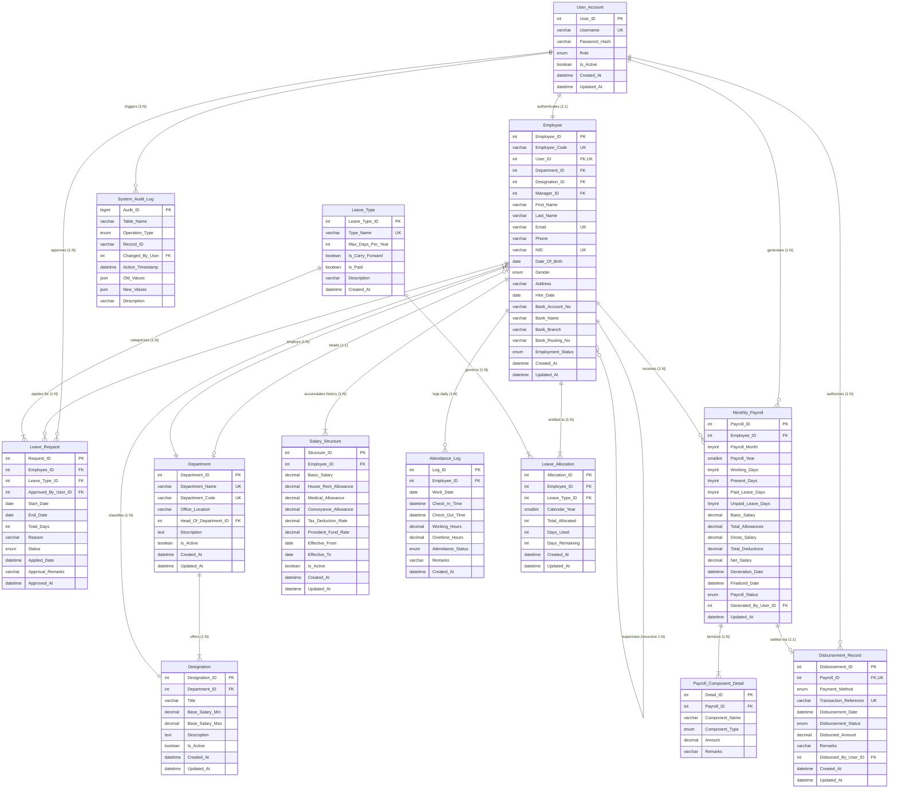

# PayPulse Entity-Relationship Diagram (ERD)

This document provides the complete, authoritative **Mermaid Entity-Relationship Diagram (ERD)** for the PayPulse database system (`paypulse_db`). The diagram uses Crow's Foot notation and accurately depicts all 13 core relational entities, primary keys, alternate keys, foreign keys, and cardinalities implemented in MySQL 8.4 LTS.

---

## 1. Complete Mermaid Crow's Foot ER Diagram

---

## 2. Relational Summary Table

| Source Entity | Relationship Description | Target Entity | Cardinality | Parent-Child Hierarchy |
|---|---|---|---|---|
| `User_Account` | Authenticates identity for | `Employee` | 1 : 1 | Parent : Child |
| `User_Account` | Approves leave applications in | `Leave_Request` | 1 : N | Parent : Child |
| `User_Account` | Generates batch vouchers in | `Monthly_Payroll` | 1 : N | Parent : Child |
| `User_Account` | Authorizes fund disbursement in | `Disbursement_Record` | 1 : N | Parent : Child |
| `User_Account` | Causes audited security actions in | `System_Audit_Log` | 1 : N | Parent : Child |
| `Department` | Offers professional positions in | `Designation` | 1 : N | Parent : Child |
| `Department` | Employs workforce members in | `Employee` | 1 : N | Parent : Child |
| `Employee` | Acts as executive head of | `Department` | 1 : 1 (circular) | Parent : Child |
| `Designation` | Classifies employees into pay bands | `Employee` | 1 : N | Parent : Child |
| `Employee` | Supervises subordinates via | `Employee` (Self) | 1 : N (recursive) | Parent : Child |
| `Employee` | Accumulates compensation revisions | `Salary_Structure` | 1 : N | Parent : Child |
| `Employee` | Logs daily punch entries in | `Attendance_Log` | 1 : N | Parent : Child |
| `Employee` | Holds annual statutory balance in | `Leave_Allocation` | 1 : N | Parent : Child |
| `Leave_Type` | Dictates entitlement rules for | `Leave_Allocation` | 1 : N | Parent : Child |
| `Employee` | Submits formal applications in | `Leave_Request` | 1 : N | Parent : Child |
| `Leave_Type` | Classifies leave reasons in | `Leave_Request` | 1 : N | Parent : Child |
| `Employee` | Receives monthly financial ledger | `Monthly_Payroll` | 1 : N | Parent : Child |
| `Monthly_Payroll` | Decomposes itemized earnings in | `Payroll_Component_Detail` | 1 : N | Parent : Child |
| `Monthly_Payroll` | Dispatched via BEFTN bank transfer | `Disbursement_Record` | 1 : 1 | Parent : Child |
