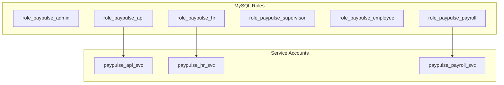
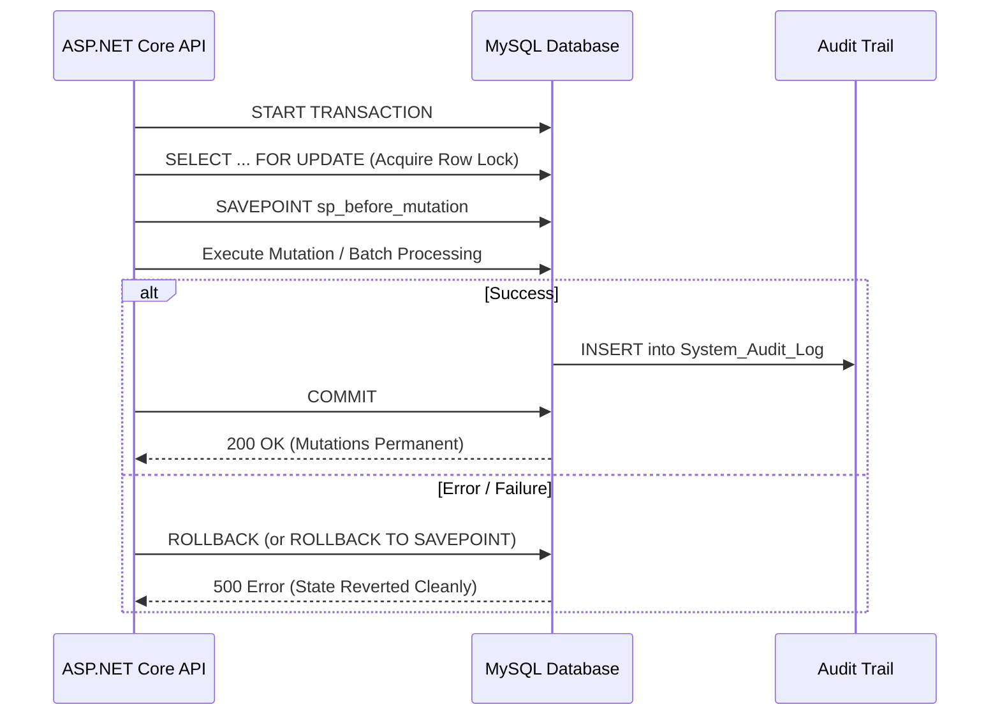

# PayPulse Security Architecture, Transactions & Concurrency

This document details the security model, Role-Based Access Control (RBAC), credential protection, least-privilege service accounts, transaction boundaries, and concurrency management strategies enforced by the PayPulse database layer.

---

## 1. Application Authorization vs Database Permissions

A critical design requirement is separating **Application Authorization** from **Database Security**:

```text
┌────────────────────────────────────────────────────────┐
│         1. Application Layer Authorization             │
│   • Authenticates individual users via JWT Bearer      │
│   • Evaluates roles: System Admin, HR, Payroll, etc.   │
│   • Authorizes fine-grained API routes and actions     │
│   • Password verified against salted BCrypt hash       │
└───────────────────────────┬────────────────────────────┘
                            │ Parameterized SQL over Connection Pool
┌───────────────────────────▼────────────────────────────┐
│         2. Database Layer Security (MySQL 8.4)         │
│   • Enforces least-privilege service account roles     │
│   • Disallows destructive DDL (DROP, TRUNCATE, ALTER)  │
│   • Enforces referential integrity and CHECK boundaries│
│   • Generates automatic audit trail via triggers       │
│   • Protects data from SQL injection via parameters    │
└────────────────────────────────────────────────────────┘
```

- **Application Authorization**: Determines which human user can call which API endpoint based on claims in their JWT token.
- **Database Security**: Controls what the application service account (`paypulse_user` / `paypulse_api_svc`) is allowed to execute against the MySQL engine. Even if an API endpoint were compromised, the service account lacks `DROP TABLE` or `TRUNCATE` rights.

---

## 2. MySQL Enterprise Roles & Least-Privilege Grants

The database provisions granular MySQL roles and service accounts:



### 2.1 Least-Privilege Principle for `role_paypulse_api`
- **Allowed Privileges**: `SELECT`, `INSERT`, `UPDATE`, `DELETE` on tables in `paypulse_db`, and `EXECUTE` on procedures and functions.
- **Denied Privileges**: Explicitly **NO DDL** (`DROP`, `ALTER`, `TRUNCATE`, `CREATE DATABASE`). Schema migrations are restricted to administrative DBA pipelines.

### 2.2 Departmental Service Role Segmentation
- `role_paypulse_hr`: Access granted to `Employee`, `Department`, `Designation`, `Attendance_Log`, `Leave_Allocation`, and `Leave_Request`. Direct modification of `Monthly_Payroll`, `Disbursement_Record`, or `Salary_Structure` is disallowed.
- `role_paypulse_payroll`: Access granted to `Salary_Structure`, `Monthly_Payroll`, `Payroll_Component_Detail`, and `Disbursement_Record`. Mutation of employee personal biographical data or designations is disallowed.

---

## 3. Sensitive Data Protection Standards

### 3.1 Cryptographic Password Protection
- Plaintext passwords are never accepted or stored.
- Seed and production user accounts store salted BCrypt hashes (work factor 12) or Argon2 hashes in `User_Account.Password_Hash`.
- Login verification occurs strictly at the backend application boundary; password hashes are excluded from all public views and DTOs.

### 3.2 Bank Account Masking
- Bank account numbers are masked across general and operational screens:
  $$\text{Raw: } 1501201982736 \longrightarrow \text{Masked: } *********2736$$
- Implemented natively via `fn_MaskBankAccount()` and exposed through `vw_DisbursementReconciliation`.
- Unmasked account numbers are restricted to backend BEFTN disbursement dispatch routines.

### 3.3 National Identity (NID) Confidentiality
- Bangladeshi National ID card numbers are unique alternate keys (`uq_emp_nid`). They are omitted from general directory views (`vw_EmployeeDirectory`) to protect employee privacy.

---

## 4. Transaction Boundaries & ACID Guarantees

All multi-step financial and lifecycle workflows enforce strict ACID transaction boundaries:



### 4.1 Automated Batch Payroll Transaction (`sp_ProcessMonthlyPayrollBatch`)
- Enforces an atomic transaction block wrapping attendance aggregation, leave tallying, master payroll record insertion, and itemized component population.
- Includes a MySQL exit handler:
  ```sql
  DECLARE EXIT HANDLER FOR SQLEXCEPTION
  BEGIN
      ROLLBACK;
      RESIGNAL;
  END;
  ```
- If an unhandled database exception occurs for any employee in the batch, the entire batch rolls back, guaranteeing zero partial or orphaned payroll entries.

### 4.2 Electronic Disbursement Transaction (`sp_DisbursePayroll`)
- Atomically inserts the `Disbursement_Record`, transitions `Monthly_Payroll.Payroll_Status` to `'Disbursed'`, and logs the transaction in `System_Audit_Log`.

---

## 5. Concurrency Control & Isolation Levels

### 5.1 Default Isolation Level
PayPulse relies on MySQL 8.4 InnoDB's default **`REPEATABLE-READ`** transaction isolation level:
- Prevents Dirty Reads and Non-Repeatable Reads.
- Uses Multi-Version Concurrency Control (MVCC) snapshots for consistent read operations without blocking concurrent writes.

### 5.2 Pessimistic Row Locking (`SELECT ... FOR UPDATE`)
To prevent concurrent race conditions during financial operations:
1. **Leave Approval Race Prevention**:
   When a supervisor approves a leave request, the stored procedure acquires an exclusive lock on the employee's `Leave_Allocation` row:
   ```sql
   SELECT Days_Remaining FROM Leave_Allocation 
   WHERE Employee_ID = ? AND Leave_Type_ID = ? AND Calendar_Year = ? 
   FOR UPDATE;
   ```
   This prevents concurrent approvals from exceeding the annual quota.
2. **Disbursement Double-Settlement Prevention**:
   Prior to dispatching a BEFTN payment, `sp_DisbursePayroll` locks the target row:
   ```sql
   SELECT Payroll_Status, Net_Salary FROM Monthly_Payroll 
   WHERE Payroll_ID = ? 
   FOR UPDATE;
   ```
   If another finance officer or background job attempts to settle the same payroll voucher concurrently, it blocks until the lock releases, after which the second worker reads `Payroll_Status = 'Disbursed'` and aborts.

---

## 6. Immutable Trigger-Driven Security Auditing

### 6.1 `System_Audit_Log` Architecture
- **Append-Only**: Application accounts have only `INSERT` and `SELECT` rights; `UPDATE` and `DELETE` privileges are strictly revoked.
- **Structured JSON Deltas**: Captures complete before-and-after states:
  ```json
  {
    "Audit_ID": 9,
    "Table_Name": "Salary_Structure",
    "Operation_Type": "UPDATE",
    "Record_ID": "106",
    "Action_Timestamp": "2026-10-12 00:15:37.491024",
    "Old_Values": {
      "Basic_Salary": 60000.00,
      "House_Rent_Allowance": 12000.00,
      "Medical_Allowance": 6000.00,
      "Tax_Deduction_Rate": 5.00
    },
    "New_Values": {
      "Basic_Salary": 65000.00,
      "House_Rent_Allowance": 12000.00,
      "Medical_Allowance": 6000.00,
      "Tax_Deduction_Rate": 5.00
    },
    "Description": "Salary structure updated for Employee ID: 106"
  }
  ```

### 6.2 Application Actor Attribution
When the backend connects via a pooled service account (`paypulse_api_svc`), the database trigger captures the acting authenticated user through MySQL session variables:
```sql
SET @acting_user_id = 1; -- Populated by ASP.NET Core middleware per authenticated request
```
The trigger binds `COALESCE(@acting_user_id, NULL)` to the audit record, preserving end-to-end accountability.
