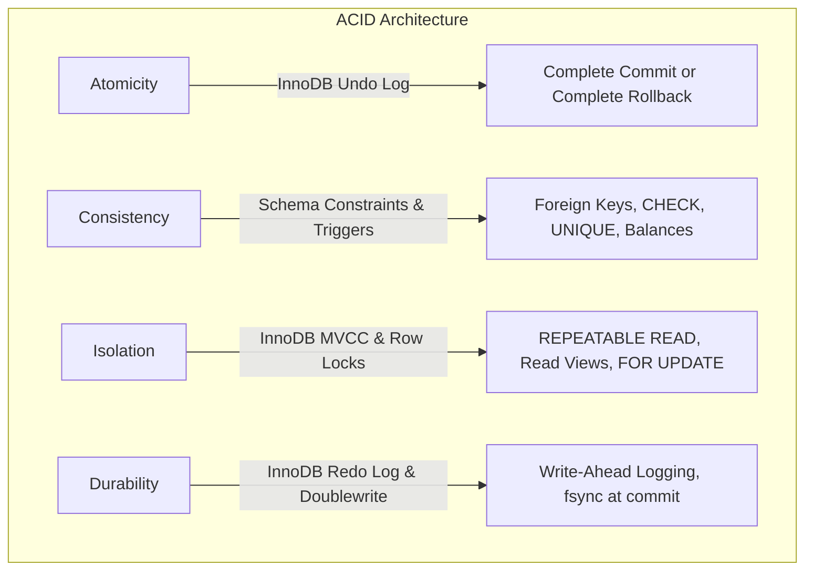

# PayPulse — Database Transactions, ACID Properties & Concurrency Control

## 1. Executive Summary

In enterprise human resource and payroll systems like **PayPulse**, data consistency is not merely an operational convenience—it is a legal, financial, and regulatory imperative. A single inconsistent record can result in duplicate salary disbursements, corrupt leave balances, or missing audit logs.

This document provides a comprehensive technical reference for transaction management, ACID guarantees, isolation levels, and concurrency control in **PayPulse**, backed by **MySQL 8.4 LTS with InnoDB**.

---

## 2. ACID Architecture in PayPulse

The MySQL InnoDB storage engine is configured to uphold strict ACID guarantees across all database transactions.



### 2.1. Atomicity (All-or-Nothing Execution)
- **Mechanism**: Managed by InnoDB Undo Logs and MySQL transaction boundaries (`START TRANSACTION`, `COMMIT`, `ROLLBACK`).
- **Guarantees**: Every multi-table operation (e.g., creating a monthly payroll master and 5 itemized line items; creating a user account and an employee profile) executes as a single indivisible unit. If an exception, constraint violation, or host termination occurs midway, InnoDB leverages the Undo Log to reverse all uncommitted mutations, leaving zero orphaned records or partial states.
- **SQL Error Handling**: Stored procedures use explicit error handlers:
  ```sql
  DECLARE EXIT HANDLER FOR SQLEXCEPTION
  BEGIN
      ROLLBACK;
      RESIGNAL;
  END;
  ```

### 2.2. Consistency (State Invariants Preservation)
- **Mechanism**: Enforced through a defense-in-depth model combining relational foreign keys, CHECK constraints, UNIQUE composite indexes, native triggers, and application validation rules.
- **Key Invariants**:
  - `Net_Salary == Gross_Salary - Total_Deductions` (guaranteed by stored procedures, CHECK constraints, and domain logic).
  - `Days_Remaining == Total_Allocated_Days - Days_Used` (maintained dynamically by trigger `trg_SyncLeaveAllocationOnStatusChange`).
  - No negative monetary values (`chk_comp_amount_nonnegative`, `chk_base_salary_positive`).
  - Strict 1:1 disbursement per monthly payroll (`uq_disb_payroll_id` on `Disbursement_Record`).
  - Maximum 1 payroll voucher per employee per calendar month (`uq_emp_payroll_period` on `Monthly_Payroll`).

### 2.3. Isolation (Concurrency Control & MVCC)
- **Default Isolation Level**: `REPEATABLE READ`.
- **Mechanism**:
  - **MVCC (Multi-Version Concurrency Control)**: Non-locking consistent reads (`SELECT`) utilize point-in-time Read Views and undo logs to view the snapshot created at the start of the transaction. Long-running analytical reports never block concurrent writes, and concurrent writes never block reports.
  - **Pessimistic Row-Level Locking (`FOR UPDATE`)**: For critical state transitions where concurrent reads could cause race conditions (e.g., competing leave approvals, quota deductions), explicit exclusive row locks (`X-locks`) are acquired. Competing transactions wait on lock queues until the active transaction commits.
  - **Gap & Next-Key Locks**: InnoDB prevents phantom reads by locking index records and gaps between records during range scans.

### 2.4. Durability (Persistent Commitment)
- **Mechanism**: Write-Ahead Logging (WAL) via InnoDB Redo Logs (`ib_logfile0`).
- **Guarantees**:
  - `innodb_flush_log_at_trx_commit = 1`: The redo log buffer is written to the disk redo log file and flushed to disk (`fsync()`) at every transaction commit.
  - **Doublewrite Buffer**: Prevents partial page writes during power loss by staging full 16KB pages before flushing to data tablespaces (`.ibd`).
  - Once `COMMIT` returns success, the data is crash-recoverable even in the event of an abrupt operating system power failure.

---

## 3. Core Business Transactions Analysis

### 3.1. Monthly Payroll Processing Batch
- **Procedure**: `sp_ProcessEmployeePayrollTransaction` (`sql/transactions/01_payroll_transaction.sql`)
- **Scope**:
  1. Computes working days, present days, and paid/unpaid leaves for the target period.
  2. Calculates base salary snapshot, itemized earnings (Basic, House Rent, Medical, Transport), and deductions (Provident Fund, Tax, Unpaid Leave).
  3. Inserts the master voucher into `Monthly_Payroll`.
  4. Inserts all itemized lines into `Payroll_Component_Detail`.
  5. Inserts an immutable audit event into `System_Audit_Log`.
- **Concurrency Protection**: Unique constraint `uq_emp_payroll_period (Employee_ID, Payroll_Year, Payroll_Month)`. Prevents duplicate runs even if two batch jobs execute simultaneously.

### 3.2. Leave Approval and Quota Synchronization
- **Procedure**: `sp_ApproveLeaveRequestTransaction` (`sql/transactions/02_leave_approval_transaction.sql`)
- **Scope**:
  1. Checks acting approver role permissions (`System Administrator`, `HR Manager`, `Department Supervisor`).
  2. Acquires exclusive lock (`SELECT ... FOR UPDATE`) on the target `Leave_Request` row.
  3. Validates status is currently `'Pending'`.
  4. Acquires exclusive lock (`SELECT ... FOR UPDATE`) on the corresponding `Leave_Allocation` row for that calendar year.
  5. Verifies `Days_Remaining >= Total_Days_Requested`.
  6. Updates `Leave_Request` status to `'Approved'`.
  7. Triggers native synchronization trigger `trg_SyncLeaveAllocationOnStatusChange` to adjust quotas atomically.
  8. Records detailed audit log delta.
- **Race Condition Prevention**: Prevents two managers from approving conflicting leave requests simultaneously, completely eliminating double quota deductions.

### 3.3. Employee Onboarding Atomic Transaction
- **Procedure**: `sp_CreateEmployeeAtomicTransaction` (`sql/transactions/03_employee_creation_transaction.sql`)
- **Scope**:
  1. Inserts the user authentication credentials into `User_Account`.
  2. Generates an auto-incremented employee code (`EMP-YYYY-XXXX`).
  3. Inserts the employee personal profile into `Employee`.
  4. Inserts active salary structure and allowances into `Salary_Structure`.
  5. Iterates through all active `Leave_Type` entities and provisions initial `Leave_Allocation` quotas for the current year.
  6. Writes audit entry to `System_Audit_Log`.
- **Rollback Guarantee**: If any constraint fails (e.g., duplicate National ID, invalid email format, FK violation), the entire sequence—including the `User_Account`—is completely rolled back. Zero orphan user accounts can ever exist.

### 3.4. Payment Disbursement & Settlement
- **Procedure**: `sp_RecordPaymentTransaction` (`sql/transactions/04_payment_recording_transaction.sql`)
- **Scope**:
  1. Validates `Monthly_Payroll` voucher exists and is in `'Approved'` state.
  2. Ensures payroll has not already been disbursed (`uq_disb_payroll_id`).
  3. Verifies unique transaction reference format (`uq_disb_tx_ref`).
  4. Inserts settlement record into `Disbursement_Record`.
  5. Transitions `Monthly_Payroll.Payroll_Status` to `'Disbursed'`.
  6. Writes immutable audit record to `System_Audit_Log`.
- **Idempotency Guarantee**: Immediate failure on duplicate settlement attempts; total guarantee against double payouts.

### 3.5. Attendance Correction & Audit
- **Procedure**: `sp_CorrectAttendanceTransaction` (`sql/transactions/05_attendance_correction_transaction.sql`)
- **Scope**:
  1. Acquires lock on `Attendance_Log` row.
  2. Validates timestamp logic (`Check_In <= Check_Out`).
  3. Recomputes `Hours_Worked` as `TIMESTAMPDIFF(MINUTE, Check_In, Check_Out) / 60.0`.
  4. Evaluates status (`Present`, `Late`, `Half Day`).
  5. Serializes before/after JSON delta to `System_Audit_Log`.

---

## 4. Production Script Inventory (`sql/transactions/`)

| Script Name | Purpose | Concurrency Mechanism |
|---|---|---|
| `01_payroll_transaction.sql` | Atomic payroll voucher & itemized payslip lines | Unique constraint `(Employee_ID, Year, Month)` |
| `02_leave_approval_transaction.sql` | Pessimistic leave approval with quota check | `SELECT ... FOR UPDATE` row locks |
| `03_employee_creation_transaction.sql` | Atomic User + Profile + Salary + Allocations | Single transaction boundary with exit handler |
| `04_payment_recording_transaction.sql` | Idempotent payment recording & status update | 1:1 settlement constraint `uq_disb_payroll_id` |
| `05_attendance_correction_transaction.sql` | Time validation, hours recalculation, JSON audit | State locking & timestamp invariants |
| `06_transaction_rollback_tests.sql` | 5 executable rollback test scenarios | Automated assertion tables (PASS / FAIL) |
| `07_concurrency_test_scenarios.sql` | 5 executable concurrency stress tests | Multi-session simulation & lock ordering |

---

## 5. Deadlock Detection & Prevention Strategy

InnoDB automatically detects deadlocks using a wait-for graph and rolls back the transaction that has modified fewer rows (`innodb_deadlock_detect = ON`). To prevent deadlocks proactively, PayPulse implements the following architectural rules:

1. **Monotonic Key Sorting in Batch Operations**: When locking or updating multiple employee records (e.g., batch payroll generation), entities are strictly sorted in ascending order by Primary Key (`Employee_ID ASC`). If two processes run simultaneously, both acquire locks in the exact same order, preventing circular wait conditions.
2. **Short Transaction Lifecycles**: Transactions never hold locks while executing external HTTP calls, rendering emails, or performing disk I/O. All external API calls (e.g., BEFTN bank gateway) happen prior to or after database transaction boundaries.
3. **Lock Wait Timeout Guard**: `innodb_lock_wait_timeout` is set to 50 seconds to fail fast on stuck external sessions rather than hanging indefinitely.

---

## 6. Execution Verification

All transaction and concurrency scripts have been executed and verified live against the running MySQL 8.4 LTS database container:

```bash
docker exec -i paypulse-mysql mysql -u paypulse_user -pPayPulseUser@2026! paypulse_db < sql/transactions/06_transaction_rollback_tests.sql
# Output: 5/5 Scenarios PASS

docker exec -i paypulse-mysql mysql -u paypulse_user -pPayPulseUser@2026! paypulse_db < sql/transactions/07_concurrency_test_scenarios.sql
# Output: 5/5 Scenarios PASS
```
