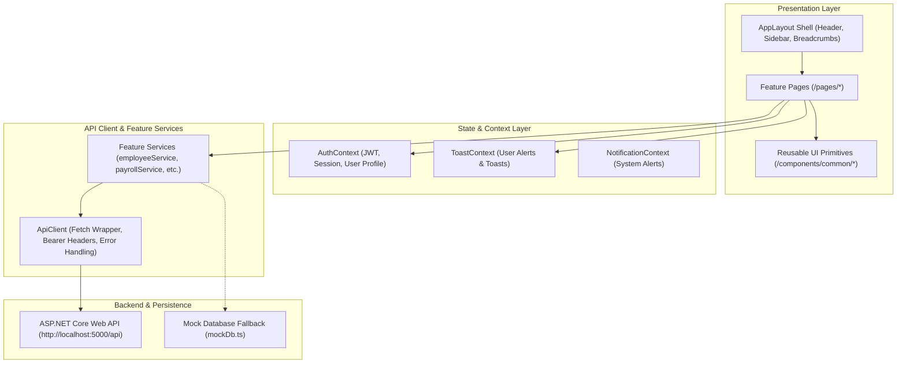

# PayPulse Frontend Architecture & Component Design

This document details the architectural principles, component structure, state management, and lifecycle patterns implemented in the **PayPulse** React frontend application.

---

## 1. Architectural Overview

The PayPulse frontend is built with **React 19**, **TypeScript**, **Vite**, and **Tailwind CSS**. It follows a modular, feature-driven architecture that guarantees clean separation among presentation components, business logic, and API communication.



---

## 2. Directory Structure

```
src/
├── app/
│   ├── config/              # Environment settings, currency, branding
│   ├── providers/           # Context providers wrapper (AppProviders)
│   └── router/              # React Router browser router configuration
├── components/
│   ├── common/              # 12 Atomic UI primitives (Badge, Modal, DataTable, etc.)
│   └── layout/              # AppLayout, Header, Sidebar, Breadcrumbs, ProtectedRoute
├── constants/
│   ├── roles.ts             # Role constants and RBAC permission sets
│   └── routes.ts            # Route path constants
├── contexts/
│   ├── AuthContext.tsx       # Authentication session & user state
│   ├── ToastContext.tsx      # Global toast notification dispatch
│   └── NotificationContext.tsx# In-app notification management
├── features/
│   └── dashboard/           # Role-tailored dashboards (Admin, HR, Payroll, Supervisor, Employee)
├── layouts/
│   └── AppLayout.tsx        # Responsive authenticated application shell
├── pages/
│   ├── auth/                # Login, ForgotPassword, Unauthorized
│   ├── common/              # NotFound (404)
│   ├── dashboard/           # Dashboard router dispatcher
│   ├── employees/           # EmployeeListPage, DetailPage, FormPage
│   ├── departments/         # DepartmentListPage, DetailPage
│   ├── designations/        # DesignationListPage
│   ├── attendance/          # AttendancePage
│   ├── leave/               # LeavePage (Requests, Types, Allocations tabs)
│   ├── salary/              # SalaryListPage, SalaryEditPage
│   ├── payroll/             # PayrollListPage, DetailPage, PayslipPage
│   ├── disbursements/       # DisbursementListPage
│   ├── reports/             # ReportsHubPage & 6 analytical report pages
│   ├── audit/               # AuditLogPage
│   └── settings/            # SettingsPage
├── services/
│   └── api/                 # ApiClient & 13 feature API services
├── styles/                  # Tailwind CSS root styles
├── types/                   # Unified TypeScript interfaces and DTOs
└── utils/                   # Currency formatters, date parsers, security helpers
```

---

## 3. State Management Strategy

PayPulse uses a lightweight, proportionate state management architecture without unnecessary external boilerplate:

1. **Global Authentication State (`AuthContext`)**:
   - Manages the active session (`user`, `accessToken`, `expiresAt`).
   - Persists credentials securely to browser `localStorage` (`paypulse_token`, `paypulse_user`).
   - Handles global session expiration via custom DOM events (`paypulse_auth_unauthorized`).
   - Provides helper methods `hasRole(allowedRoles)` and `hasPermission(permission)`.

2. **UI Feedback State (`ToastContext`)**:
   - Centralized toast dispatcher (`showToast(type, title, message)`).
   - Provides accessible, auto-dismissing notifications for success, warning, error, and info events.

3. **In-App Alerts (`NotificationContext`)**:
   - Polling and retrieval of corporate notifications (leave approvals, payroll finalization, biometric reminders).

4. **Server State & Feature State**:
   - Handled via component-level asynchronous hooks (`useState`, `useEffect`, `useCallback`).
   - Guarantees immediate cache invalidation and UI state synchronicity after CRUD mutations.

---

## 4. API Client & Transport Layer (`ApiClient`)

The centralized `ApiClient` (`src/services/api/apiClient.ts`) wraps the browser Fetch API:
- **Base URL Resolution**: Injects `config.apiBaseUrl` from environment configuration (`http://localhost:5000/api`).
- **Authorization Headers**: Injects `Authorization: Bearer <token>` on all outbound requests.
- **Error Normalization**: Maps HTTP 400, 401, 403, 404, 409, and 500 responses into structured `ApiError` objects containing server-supplied error messages and field validation dictionaries.
- **Session Eviction**: Automatically intercepts 401 Unauthorized responses to purge expired tokens and redirect users to `/login`.
