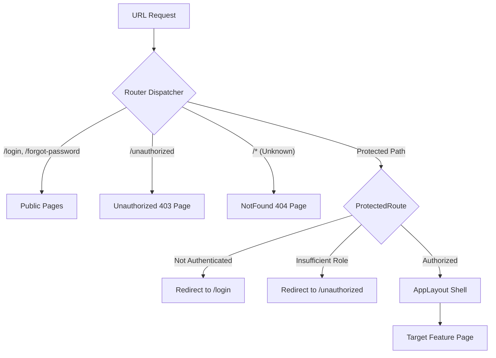

# Routes, Navigation & Role-Based Permissions Reference

This document maps all application routes, navigational menus, and client-side access control rules enforced in the **PayPulse** frontend.

---

## 1. Routing Architecture

PayPulse utilizes **React Router 7** with `createBrowserRouter`. Routes are partitioned into **Public Routes** and **Protected Application Routes** wrapped inside [`AppLayout`](file:///home/noir/Projects/PayPulse/src/layouts/AppLayout.tsx).

---

## 2. Complete Application Route Map

| URL Path | Component | Guard / Allowed Roles | Purpose |
| :--- | :--- | :--- | :--- |
| `/login` | `LoginPage` | Public | Credential authentication |
| `/forgot-password` | `ForgotPasswordPage` | Public | Password recovery dispatch |
| `/unauthorized` | `UnauthorizedPage` | Public | Forbidden (403) warning screen |
| `/dashboard` | `DashboardPage` | All Authenticated | Role-tailored executive & self-service overview |
| `/employees` | `EmployeeListPage` | Admin, HR Manager | Workforce directory & search |
| `/employees/new` | `EmployeeFormPage` | Admin, HR Manager | Employee onboarding form |
| `/employees/:id` | `EmployeeDetailPage` | All Authenticated | Biographical, banking & departmental profile |
| `/employees/:id/edit`| `EmployeeFormPage` | Admin, HR Manager | Update employee profile |
| `/departments` | `DepartmentListPage` | Admin, HR Manager | Organizational business units |
| `/departments/:id` | `DepartmentDetailPage`| All Authenticated | Department workforce list |
| `/designations` | `DesignationListPage`| Admin, HR Manager | Job titles & statutory salary brackets |
| `/attendance` | `AttendancePage` | All Authenticated | Biometric punch-in/out & attendance logs |
| `/leave` | `LeavePage` | All Authenticated | Leave quotas, applications & approvals |
| `/salary` | `SalaryListPage` | Admin, HR, Payroll | Compensation structures & salary bands |
| `/salary/:id/edit` | `SalaryEditPage` | Admin, HR, Payroll | Revise compensation package |
| `/payroll` | `PayrollListPage` | All Authenticated | Monthly payroll ledger & self-service view |
| `/payroll/:id` | `PayrollDetailPage` | All Authenticated | Payslip breakdown & line items |
| `/payroll/:id/payslip`| `PayslipPage` | All Authenticated | Printable / PDF formatted payslip |
| `/disbursements` | `DisbursementListPage`| Admin, Payroll Officer | BEFTN banking disbursement log |
| `/reports` | `ReportsHubPage` | Admin, HR, Payroll, Supervisor | Analytical reporting portal |
| `/reports/payroll` | `PayrollCostReportPage`| Admin, HR, Payroll, Supervisor | Departmental payroll expenditure |
| `/reports/attendance`| `AttendanceReportPage` | Admin, HR, Payroll, Supervisor | Biometric attendance trends |
| `/reports/leave` | `LeaveUtilizationReportPage`| Admin, HR, Payroll, Supervisor | Leave quota utilization |
| `/reports/tax` | `TaxProvidentReportPage` | Admin, HR, Payroll | Income tax & PF deposit summary |
| `/audit` | `AuditLogPage` | **System Administrator Only** | Immutable system security audit trail |
| `/settings` | `SettingsPage` | **System Administrator Only** | Corporate configuration & policies |
| `*` | `NotFoundPage` | Public | 404 page for nonexistent routes |

---

## 3. Role-Based Access Control (RBAC) Matrix

The constant `ROLE_PERMISSIONS` in [`src/constants/roles.ts`](file:///home/noir/Projects/PayPulse/src/constants/roles.ts) defines permitted role groups:

| Role | Dashboard View | Employees | Organization | Salary | Payroll | Disbursements | Reports | Audit |
| :--- | :---: | :---: | :---: | :---: | :---: | :---: | :---: | :---: |
| **System Administrator** | Admin | Full | Full | Full | Full | Full | Full | Full |
| **HR Manager** | HR | Full | Full | Full | View | View | Full | None |
| **Payroll Officer** | Payroll | Read | Read | Full | Full | Full | Full | None |
| **Department Supervisor**| Supervisor | Read (Dept) | Read | None | Self | None | Dept | None |
| **Employee** | Employee | Read (Self) | Read | Self | Self | None | None | None |

---

## 4. Adaptive Sidebar Navigation

The application sidebar in [`src/components/layout/Sidebar.tsx`](file:///home/noir/Projects/PayPulse/src/components/layout/Sidebar.tsx) automatically filters visible navigation items based on the current user's role:
- Links requiring elevated privileges (such as *Audit Logs* or *Disbursements*) are omitted for regular employees.
- Prevents UI clutter and eliminates unauthorized navigation attempts.
